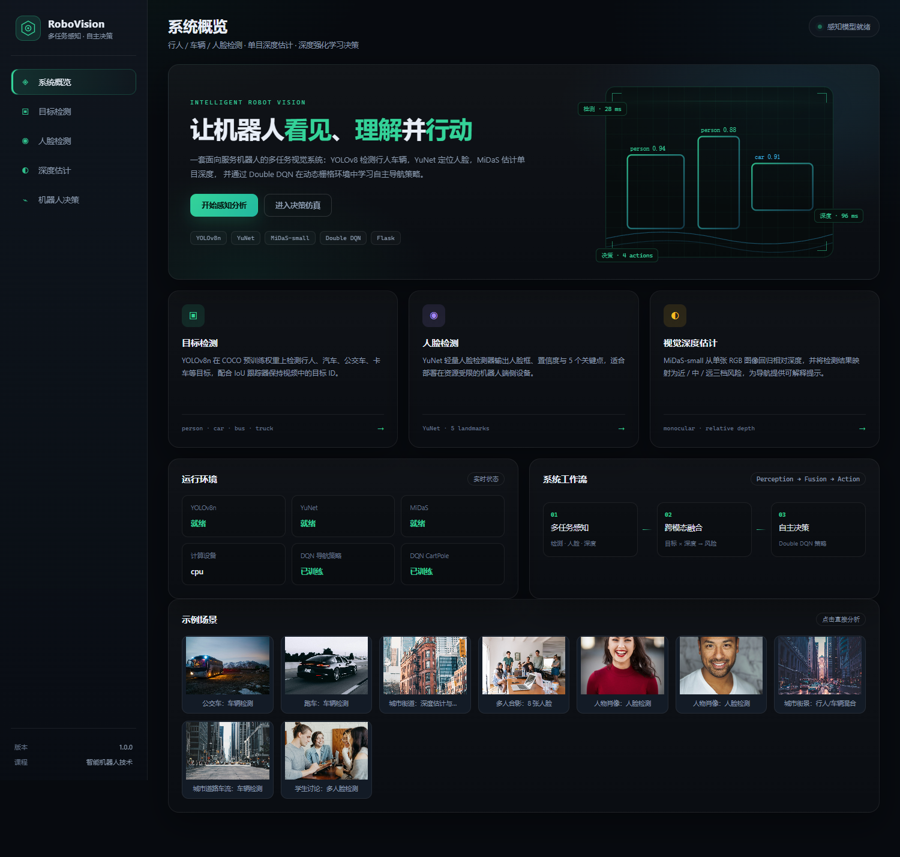
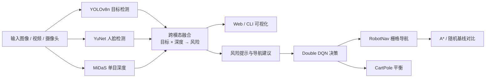
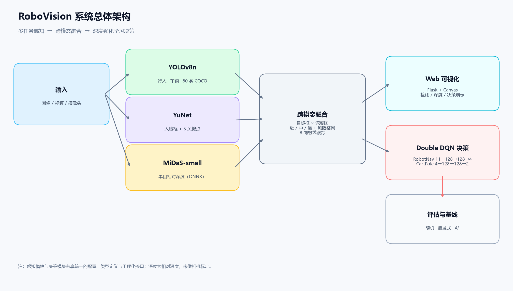
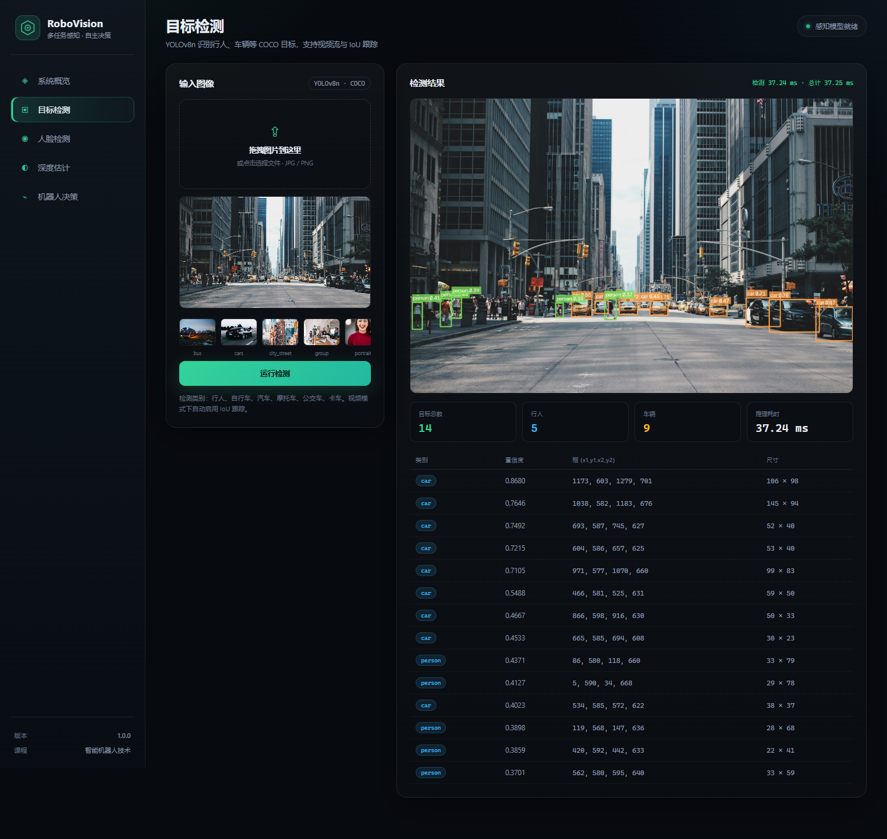
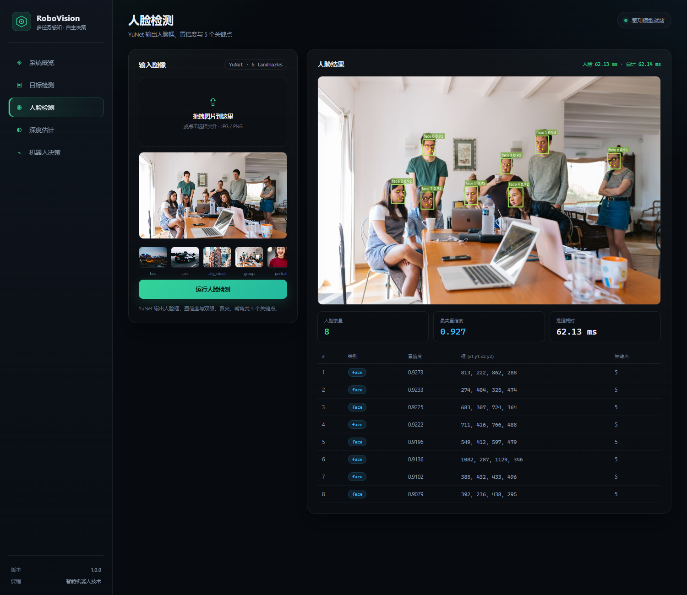
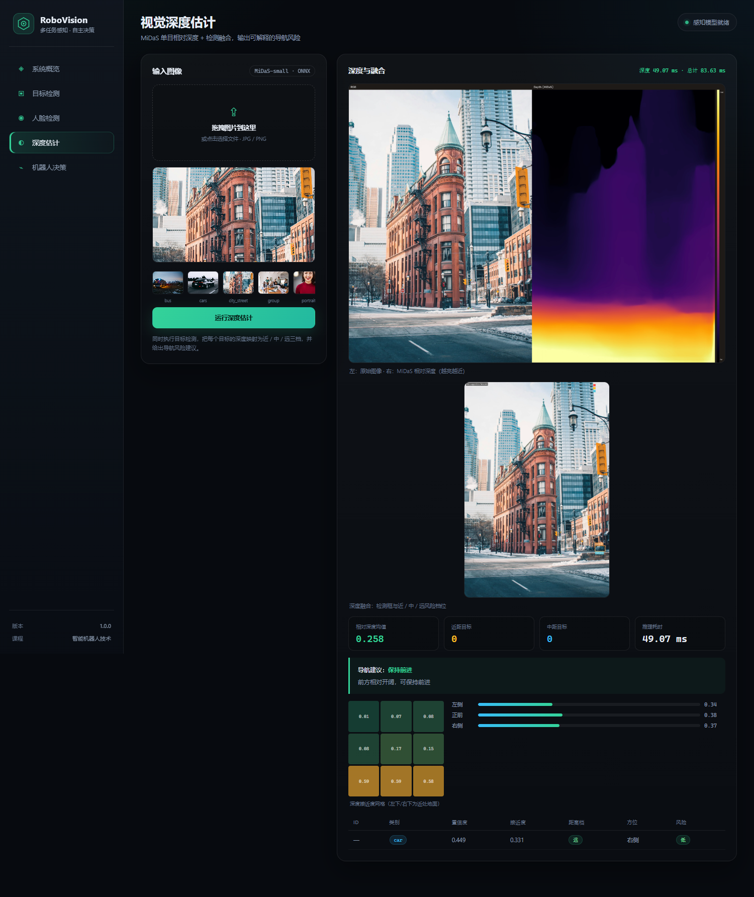
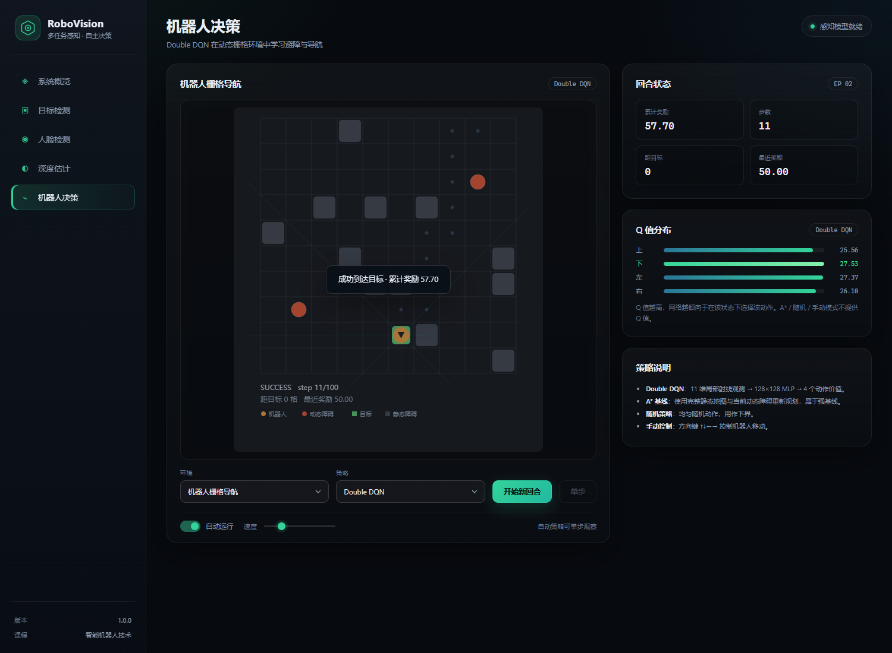
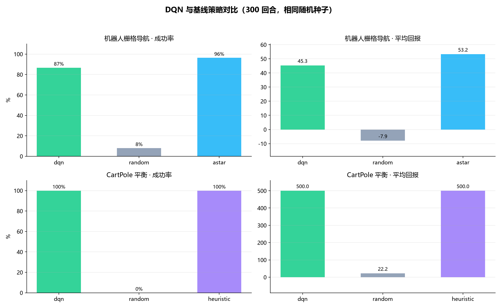

# RoboVision · 智能机器人多任务感知与决策系统

[](https://github.com/clovernoah/RoboVision/actions/workflows/ci.yml)

> 智能机器人技术课程大作业
>
> 目标检测（行人 / 车辆 / 人脸） · 单目视觉深度估计 · 深度强化学习决策

RoboVision 将三个独立能力整合成一套**面向服务机器人的感知—融合—决策闭环**：YOLOv8n 检测行人与车辆，YuNet 定位人脸，MiDaS 估计单目相对深度；深度融合结果转化为近 / 中 / 远风险与导航建议；Double DQN 在自研机器人栅格导航环境中学习避障策略，并在 CartPole 上验证算法正确性。项目提供 Web 仪表盘、命令行工具、训练/评估脚本、32 项单元测试与可复现实验数据。



## 1. 功能一览

| 模块 | 实现 | 说明 |
|---|---|---|
| 行人 / 车辆检测 | YOLOv8n（COCO 预训练，Ultralytics） | person、bicycle、car、motorcycle、bus、truck；支持图片、视频、摄像头；自研 IoU 跟踪器保持视频目标 ID |
| 人脸检测 | OpenCV YuNet（ONNX） | 人脸框、置信度、双眼/鼻尖/嘴角 5 关键点；单模型仅 0.22 MB |
| 视觉深度估计 | MiDaS-small（ONNX Runtime） | 单张 RGB 回归相对深度；伪彩色、点云导出、检测框 ROI 深度统计 |
| 跨模态融合 | 自研规则融合 | 目标框 × 深度图 → 近/中/远档位、3×3 风险网格、左/中/右通道接近度、可解释导航建议 |
| 智能决策 | 纯 PyTorch 实现的 DQN / Double DQN | CartPole + 自研 RobotNavEnv；经验回放、目标网络、ε-greedy、Double Q 更新 |
| 决策基线 | 随机、CartPole 启发式、A* | 与 DQN 在相同随机种子上对比成功率、回报、步数、碰撞率 |
| Web 演示 | Flask + 原生 HTML/CSS/JS | 图片上传分析、摄像头 MJPEG、Canvas 实时仿真、Q 值可视化，无前端构建与 CDN 依赖 |
| 工程化 | 配置、CLI、测试、基准、报告生成 | 统一 YAML 配置、lazy load、线程锁、pytest、延迟基准、报告插图脚本 |

## 2. 系统架构





## 3. 快速开始

### 3.1 环境要求

- Windows 10/11、Linux 或 macOS
- Python 3.10+（本项目在 **Python 3.14.0 + Windows 11** 上完整验证）
- 无需 GPU；CPU 即可实时运行。如有 NVIDIA GPU，可另行安装对应 CUDA 版 PyTorch
- 首次安装依赖约 **1.3 GB**（主要是 CPU 版 PyTorch），模型约 **71 MB**

### 3.2 安装位置说明

所有依赖安装在**项目内的隔离虚拟环境** `.venv/` 中：

```
<项目根目录>/
├── .venv/                      # 隔离虚拟环境（约 1.3–1.4 GB）
│   ├── Scripts/python.exe      # Windows
│   ├── bin/python              # Linux / macOS
│   └── Lib/site-packages/      # 依赖包（Linux 下为 lib/python3.x/site-packages）
├── models/                     # 预训练权重（约 71 MB）
├── assets/samples/             # 示例图片（约 2.2 MB）
├── runs/                       # 训练/评估产物
└── docs/images/                # 报告插图
```

不会污染系统 Python 环境；删除 `.venv/` 即可完全卸载依赖。

### 3.3 安装与下载

```bash
# 0) 获取代码并进入项目目录（将 <your-repo-url> 替换为实际仓库地址）
git clone <your-repo-url> Intelligent_robot_technology
cd Intelligent_robot_technology

# 1) 创建虚拟环境
python -m venv .venv

# 2) 激活虚拟环境（按当前终端选择一条）
# Windows PowerShell:
.venv\Scripts\Activate.ps1
# 若提示禁止运行脚本：Set-ExecutionPolicy -Scope Process Bypass
# Windows CMD:
.venv\Scripts\activate.bat
# Linux / macOS:
source .venv/bin/activate

# 3) 安装依赖（国内建议使用清华镜像）
python -m pip install -r requirements.txt
# 或：python -m pip install -i https://pypi.tuna.tsinghua.edu.cn/simple -r requirements.txt

# 4) 下载并校验三个预训练模型
python scripts/download_models.py --verify

# 5) 下载示例图片（可选，Web 与报告需要）
python scripts/download_assets.py
```

> Linux/macOS 若系统没有 `python` 命令，请使用 `python3`。
> 如果不想激活虚拟环境，可将后文命令中的 `python` 替换为 `.venv\Scripts\python.exe`（Windows）或 `.venv/bin/python`（Linux/macOS）。

`download_models.py` 支持多镜像重试与断点文件校验，模型清单如下：

| 文件 | 大小 | 用途 | 来源 |
|---|---:|---|---|
| `models/yolov8n.pt` | 6.25 MB | 行人/车辆检测 | Ultralytics Assets |
| `models/face_detection_yunet_2023mar.onnx` | 0.22 MB | 人脸检测 | OpenCV Zoo |
| `models/midas_small.onnx` | 63.67 MB | 单目深度 | Intel ISL MiDaS Release |

### 3.4 启动 Web 演示

```bash
python -m robotvision web
```

浏览器打开 <http://127.0.0.1:5000>。

也可以直接打开内置演示深链：

| 链接 | 效果 |
|---|---|
| `http://127.0.0.1:5000/?demo=detect` | 自动加载街景并运行目标检测 |
| `http://127.0.0.1:5000/?demo=face` | 自动加载 8 人合影并运行人脸检测 |
| `http://127.0.0.1:5000/?demo=depth` | 自动运行深度估计与风险融合 |
| `http://127.0.0.1:5000/?demo=decision` | 自动开始一局 DQN 导航仿真 |

> 首次分析会加载模型，可能耗时 1–3 秒；之后检测约 20–30 ms/帧（CPU）。

## 4. 使用方式

### 4.1 Web 仪表盘

- **目标检测**：上传/拖拽图片，显示标注框、置信度、类别统计、目标列表与推理耗时；支持摄像头 MJPEG 流（`/video_feed?mode=detect`）。
- **人脸检测**：显示人脸框、5 个关键点和多人脸统计。
- **深度估计**：原图与 MiDaS 伪彩色对比、3×3 深度接近度网格、左/中/右通道风险条、导航建议、检测目标距离档位表。
- **机器人决策**：Canvas 实时绘制栅格、静态/动态障碍、8 向射线、轨迹与 Q 值；支持 DQN、A*、随机、手动四种策略与自动/单步运行。






### 4.2 命令行

```bash
# 联合分析（检测 + 人脸 + 深度 + 融合）
python -m robotvision analyze --source assets/samples/street_traffic.jpg --out runs/demo

# 单项能力
python -m robotvision detect --source assets/samples/bus.jpg --out runs/detect
python -m robotvision face   --source assets/samples/group.jpg --out runs/face
python -m robotvision depth  --source assets/samples/city_street.jpg --out runs/depth --pointcloud

# 视频 / 摄像头
python -m robotvision detect --source path/to/video.mp4 --out runs/video
python -m robotvision detect --source 0 --out runs/camera

# 状态检查
python -m robotvision info
```

图片输出包括 `annotated.jpg`、`depth_panel.jpg`、`fused.jpg`、`result.json`，深度模式可额外生成 `pointcloud.ply`。视频输出 `annotated.mp4`。

### 4.3 训练与评估

```bash
# 机器人导航：Double DQN，1200 回合（CPU 约 35 秒）
python scripts/train_dqn.py --env robotnav --episodes 1200

# CartPole：500 回合（CPU 约 78 秒）
python scripts/train_dqn.py --env cartpole --episodes 500

# 普通 DQN 消融
python scripts/train_dqn.py --env robotnav --episodes 1200 --no-double --out runs/robotnav_vanilla

# 300 回合评估，并与随机 / A* / 启发式对比
python scripts/evaluate_dqn.py --env robotnav --episodes 300
python scripts/evaluate_dqn.py --env cartpole --episodes 300
```

训练产物：`runs/<env>/best.pt`、`last.pt`、`metrics.csv`、`summary.json`、`training_curve.png`；评估产物：`eval_all.json`、`episode.gif`。

> 仓库已包含演示用的 DQN 检查点：`runs/robotnav/best.pt`、`runs/cartpole/best.pt`、`runs/robotnav_vanilla/best.pt`。克隆后无需重新训练即可体验决策页；重新运行训练脚本会覆盖这些文件。

### 4.4 性能基准、测试与报告插图

```bash
python scripts/benchmark.py --iterations 12
python -m pytest -q
python scripts/make_report_assets.py
```

## 5. 实验结果摘要

### 5.1 感知性能（CPU，640×480–1280×1905 图片，12 次均值）

| 任务 | 平均延迟 | P95 | 吞吐 |
|---|---:|---:|---:|
| 目标检测（YOLOv8n） | 20.35 ms | 26.47 ms | 49.1 FPS |
| 人脸检测（YuNet） | 73.37 ms | 119.25 ms | 13.6 FPS |
| 深度估计（MiDaS-small） | 33.34 ms | 39.61 ms | 30.0 FPS |
| 完整流水线（检测+人脸+深度+融合） | 132.83 ms | 187.65 ms | 7.5 FPS |

### 5.2 决策策略对比（300 回合，相同随机种子）

| 环境 | 策略 | 成功率 | 平均回报 | 平均步数 | 碰撞率 |
|---|---|---:|---:|---:|---:|
| RobotNav | **Double DQN** | **86.7%** | 45.31 | 14.7 | 7.7% |
| RobotNav | 随机策略 | 8.0% | −7.93 | 53.0 | 64.7% |
| RobotNav | A*（完整地图） | 96.3% | 53.24 | 8.5 | 3.7% |
| CartPole | **Double DQN** | **100.0%** | 500.00 | 500.0 | — |
| CartPole | 随机策略 | 0.0% | 22.16 | 22.2 | — |
| CartPole | 启发式 | 100.0% | 500.00 | 500.0 | — |



DQN 在仅有 8 向局部射线、6 格探测距离的条件下达到 86.7% 成功率，显著优于随机策略；A* 使用完整地图与动态障碍位置，属于信息更充分的强基线，两者差距反映了**部分可观测性**带来的代价。完整分析见 [课程设计报告](docs/课程设计报告.md)。

## 6. 目录结构

```
Intelligent_robot_technology/
├── README.md
├── requirements.txt
├── configs/default.yaml              # 统一配置
├── robotvision/
│   ├── config.py / types.py / utils.py
│   ├── models/                       # YOLOv8 / YuNet / MiDaS / IoU 跟踪
│   ├── pipelines/                    # 感知编排与可视化
│   ├── fusion/navigation.py          # 检测×深度风险融合
│   ├── decision/                     # 环境、DQN、训练、评估、基线
│   ├── web/                          # Flask 应用与前端
│   └── cli.py
├── scripts/                          # 下载、训练、评估、基准、报告插图
├── models/                           # 预训练权重（gitignore）
├── assets/samples/                   # 示例图片与来源
├── runs/                             # 训练/评估/基准产物（gitignore）
├── tests/                            # 32 项 pytest
└── docs/
    ├── 课程设计报告.md
    └── images/                       # 报告与 README 插图
```

## 7. 关键设计说明

- **为什么不是三个独立 demo**：统一的数据类型、配置、可视化与 Web 接口；深度融合把检测框映射为风险档位，DQN 则作为“决策层”与感知层解耦，形成完整机器人系统。
- **深度是相对深度**：MiDaS 未做相机标定，因此不输出绝对米制距离，而是归一化接近度与近/中/远三档。报告中对这一点有明确说明。
- **跟踪器自研**：IoU 贪心匹配 + 轨迹老化，避免引入额外跟踪依赖，便于讲解与测试。
- **DQN 从零实现**：不依赖 Stable-Baselines3 / Gym；环境、回放池、目标网络、Double Q 更新全部可读可测。
- **A* 基线的信息优势**：A* 使用完整静态地图并每步重规划，DQN 只能看到局部射线；报告中将该差异作为实验分析的一部分。

## 8. 模型、数据与许可

| 资源 | 来源 | 许可 |
|---|---|---|
| YOLOv8n | [Ultralytics](https://github.com/ultralytics/ultralytics) | AGPL-3.0 |
| YuNet | [OpenCV Zoo](https://github.com/opencv/opencv_zoo) | Apache-2.0 |
| MiDaS-small | [Intel ISL MiDaS](https://github.com/isl-org/MiDaS) | MIT |
| 示例图片 | Unsplash / Pexels（详见 `assets/samples/SOURCES.json`） | 各平台许可 |

本项目仅用于课程学习与演示。

## 9. 常见问题

**Q：第一次点击“运行检测”很慢？**  
A：模型采用懒加载，首次会初始化 PyTorch / ONNX Runtime 并预热网络，约 1–3 秒；后续单帧检测约 20–30 ms。

**Q：没有摄像头怎么办？**  
A：Web 的检测/人脸/深度均支持图片上传；`/video_feed` 在摄像头不可用时返回 503，不影响其他功能。

**Q：如何使用 GPU？**  
A：安装与 CUDA 匹配的 PyTorch 轮子（如 `pip install torch torchvision --index-url https://download.pytorch.org/whl/cu128`），把 `configs/default.yaml` 中 `detection.device` 改为 `0`，或保持 `auto` 自动检测。深度模型走 ONNX Runtime CPU，不受影响。

**Q：标注图上的文字为什么是英文？**  
A：OpenCV 内置字体不支持中文，类别名保持 COCO 英文；Web 界面、报告与统计均为中文。

**Q：端口 5000 被占用？**  
A：`python -m robotvision web --port 5001`。
