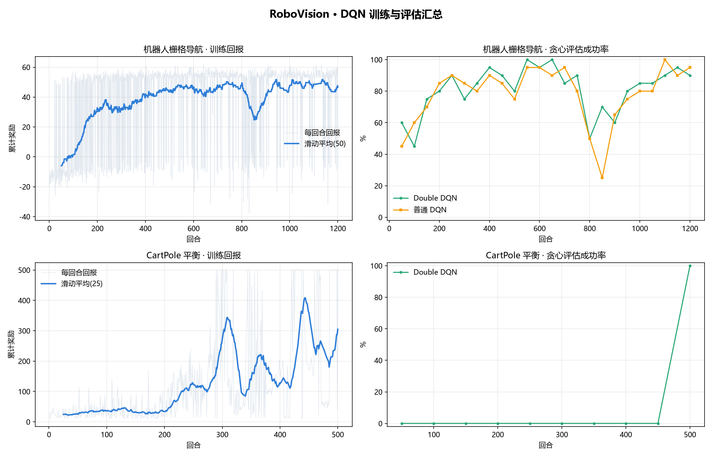
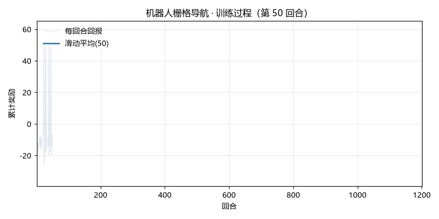
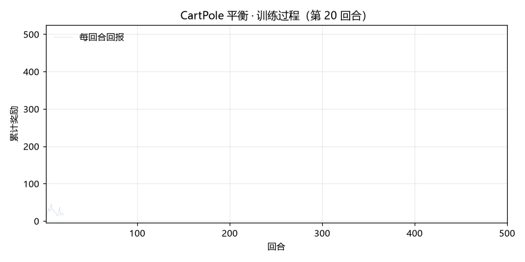
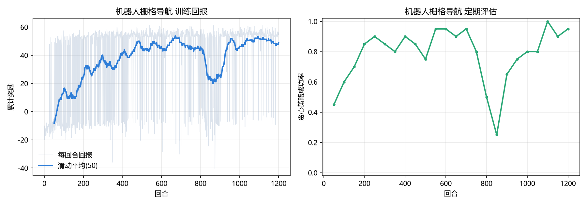

# RoboVision DQN 训练过程记录

本目录保存强化学习部分的完整训练过程：训练代码入口、逐回合指标、终端日志、训练曲线、训练 GIF、检查点说明、评估结果和 Double DQN 消融实验。

> 说明：目标检测、人脸检测和深度估计使用预训练模型做推理，本项目**没有**在本地重新训练这三个感知模型。这里记录的是从零实现的 **DQN / Double DQN** 训练过程。

## 1. 实验环境

| 项目 | 配置 |
|---|---|
| 操作系统 | Windows 11 (10.0.26200) |
| CPU | x86-64 桌面 CPU，未启用 CUDA |
| Python | 3.14.0 |
| PyTorch | 2.14.1+cpu |
| 训练设备 | CPU |
| 随机种子 | 42 |

## 2. 训练任务

| 任务 | 环境 | 算法 | 训练回合 | 实际耗时 | 最佳回合 |
|---|---|---|---:|---:|---:|
| 经典控制 | CartPole | Double DQN | 500 | 77.6 s | 500 |
| 机器人导航 | RobotNavEnv 10×10 | Double DQN | 1200 | 34.9 s | 550 |
| 消融对照 | RobotNavEnv 10×10 | 普通 DQN | 1200 | 33.8 s | 1100 |

RobotNavEnv 的配置：

- 10×10 栅格；
- 约 12 个静态障碍；
- 2 个随机游走动态障碍；
- 8 向射线，最大探测距离 6 格；
- 观测 11 维，动作 4 个（上/下/左/右）；
- 单回合最多 100 步。

## 3. 超参数

| 参数 | 取值 |
|---|---|
| 网络结构 | 观测 → 128 → 128 → 动作数 |
| 激活函数 | ReLU |
| 学习率 | 1×10⁻³ |
| 折扣因子 γ | 0.99 |
| 批大小 | 64 |
| 经验回放容量 | 50,000 |
| 目标网络同步 | 每 200 次更新 |
| ε-greedy | 1.0 → 0.05，前 60% 回合线性衰减 |
| 损失函数 | Smooth L1（Huber） |
| 优化器 | Adam |
| 梯度裁剪 | 10 |
| Double DQN | 开启（消融实验关闭） |
| 评估频率 | 每 50 回合，贪心评估 20 回合 |

## 4. 运行命令

```bash
# 机器人导航：Double DQN
python scripts/train_dqn.py --env robotnav --episodes 1200

# CartPole
python scripts/train_dqn.py --env cartpole --episodes 500

# 消融：普通 DQN
python scripts/train_dqn.py --env robotnav --episodes 1200 --no-double --out runs/robotnav_vanilla

# 300 回合评估
python scripts/evaluate_dqn.py --env robotnav --episodes 300
python scripts/evaluate_dqn.py --env cartpole --episodes 300

# 重新生成本目录中的图表/GIF
python scripts/make_training_assets.py
```

训练入口：

- `scripts/train_dqn.py`：命令行参数解析；
- `robotvision/decision/train.py`：训练循环、日志、检查点、曲线；
- `robotvision/decision/dqn.py`：Q 网络、回放池、Double DQN 更新；
- `robotvision/decision/envs/`：CartPole 与 RobotNavEnv；
- `robotvision/decision/evaluate.py`：评估与回合 GIF。

## 5. 训练产物

### 5.1 逐回合指标 `*_metrics.csv`

每一行对应一个训练回合，字段为：

| 字段 | 含义 |
|---|---|
| `episode` | 回合编号 |
| `return` | 本回合累计奖励 |
| `steps` | 本回合步数 |
| `success` | 是否成功（1/0） |
| `collision` | 是否碰撞（1/0） |
| `epsilon` | 当前探索率 |
| `loss` | 本回合平均 TD 损失 |
| `eval_success` | 该回合触发的贪心评估成功率（每 50 回合） |
| `eval_return` | 贪心评估平均回报 |
| `eval_steps` | 贪心评估平均步数 |
| `elapsed_s` | 累计训练时间 |

本目录包含：

```
robotnav_metrics.csv          1200 回合
cartpole_metrics.csv           500 回合
robotnav_vanilla_metrics.csv  1200 回合
```

### 5.2 终端日志

```
train_robotnav.log
train_cartpole.log
train_robotnav_vanilla.log
```

日志每隔 10 回合打印一次训练回报、步数、ε、loss；每 50 回合打印贪心评估成功率。

### 5.3 检查点与摘要

模型文件保存在仓库的 `runs/` 下：

```
runs/robotnav/best.pt
runs/robotnav/last.pt
runs/cartpole/best.pt
runs/cartpole/last.pt
runs/robotnav_vanilla/best.pt
```

`best.pt` 按“评估成功率 × 1000 + 平均回报”选择；`last.pt` 是最后一回合的模型。本目录同时保存了对应的 `*_summary.json`。

## 6. 训练结果



### 6.1 RobotNav：Double DQN




- 训练回报从约 −20 上升到 +45 左右；
- 贪心评估成功率在 50%–100% 之间波动；
- 最佳检查点出现在第 550 回合；
- 300 回合独立评估：成功率 **86.7%**，平均回报 45.31，平均步数 14.7，碰撞率 7.7%。

### 6.2 CartPole：Double DQN




- 前 200 回合回报快速上升，随后在高位波动；
- 第 500 回合贪心评估达到 100%；
- 300 回合独立评估：成功率 **100%**，平均回报 500。

### 6.3 消融：Double DQN vs 普通 DQN



使用相同网络结构、相同 1200 回合、相同随机种子训练普通 DQN，并在同一组 500 个评估种子上配对比较：

| 策略 | 成功率 | 平均回报 | 平均步数 | 碰撞率 | 超时率 |
|---|---:|---:|---:|---:|---:|
| Double DQN | 85.4% | 44.20 | 15.25 | 8.4% | 6.2% |
| 普通 DQN | 88.6% | 47.95 | 15.15 | 6.2% | 5.2% |

配对结果：都成功 403 局，仅 Double 成功 24 局，仅普通 DQN 成功 40 局，都失败 33 局。McNemar 检验：

$$
\chi^2 = \frac{(|40-24|-1)^2}{40+24} \approx 3.52,\quad p \approx 0.06
$$

在 0.05 显著性水平下差异不显著。报告中对此做了如实分析：该任务规模较小，Double DQN 抑制过估计的理论优势没有转化为显著性能提升；动态障碍和随机地图也带来较大评估方差。

## 7. 评估方法

- 评估使用 300 回合（主表）或 500 回合（消融配对）；
- 评估种子从 `30000` 开始，各策略使用相同种子；
- DQN 使用贪心策略（ε = 0）；
- 基线：
  - 随机策略；
  - CartPole 启发式；
  - RobotNav 的 A*（使用完整静态地图，并把当前动态障碍视为临时障碍，每步重规划）。

主评估结果：

| 环境 | 策略 | 成功率 | 平均回报 | 平均步数 | 碰撞率 |
|---|---|---:|---:|---:|---:|
| RobotNav | Double DQN | 86.7% | 45.31 | 14.7 | 7.7% |
| RobotNav | 随机 | 8.0% | −7.93 | 53.0 | 64.7% |
| RobotNav | A* | 96.3% | 53.24 | 8.5 | 3.7% |
| CartPole | Double DQN | 100% | 500.00 | 500.0 | — |
| CartPole | 随机 | 0% | 22.16 | 22.2 | — |
| CartPole | 启发式 | 100% | 500.00 | 500.0 | — |

## 8. 文件清单

| 文件 | 内容 |
|---|---|
| `robotnav_metrics.csv` | RobotNav Double DQN 逐回合指标 |
| `cartpole_metrics.csv` | CartPole 逐回合指标 |
| `robotnav_vanilla_metrics.csv` | 普通 DQN 逐回合指标 |
| `train_*.log` | 训练终端日志 |
| `*_training_curve.png` | 单次训练曲线 |
| `*_training_progress.gif` | 训练过程动画 |
| `training_dashboard.png` | 汇总面板 |
| `*_eval_all.json` | 300 回合评估明细 |
| `evaluation_summary.json` | 主评估汇总 |
| `ablation_double_vs_vanilla.json` | 500 回合配对消融数据 |
| `*_summary.json` | 训练摘要、耗时、检查点信息 |

## 9. 局限说明

- 感知模型（YOLO/YuNet/MiDaS）使用预训练权重，没有本地训练数据；
- 训练在 CPU 上完成，耗时为当前机器的参考值；
- RobotNav 的评估结果受动态障碍随机性影响；
- A* 拥有完整地图信息，DQN 只有局部射线，二者存在信息不对称；
- 本目录的训练记录比仓库原有的 `docs/images` 更完整，包含逐回合 CSV、日志和 GIF。

## 10. 一键更新

重新训练后，运行：

```bash
python scripts/make_training_assets.py
```

脚本会自动把最新的 metrics、日志、曲线和评估结果复制到本目录，并重新生成汇总图和 GIF。
